# VoxRelay AI

> A multi-tenant voice operations control plane for governed inbound-call automation, human escalation, quality review, release management, and privacy-aware audit evidence.

[](LICENSE)
[](https://github.com/HUSNAIN-MUNAWAR/voxrelay-ai/actions/workflows/ci.yml)
[](https://www.python.org/downloads/)
[](https://fastapi.tiangolo.com/)
[](https://nextjs.org/)
[](docker-compose.yml)

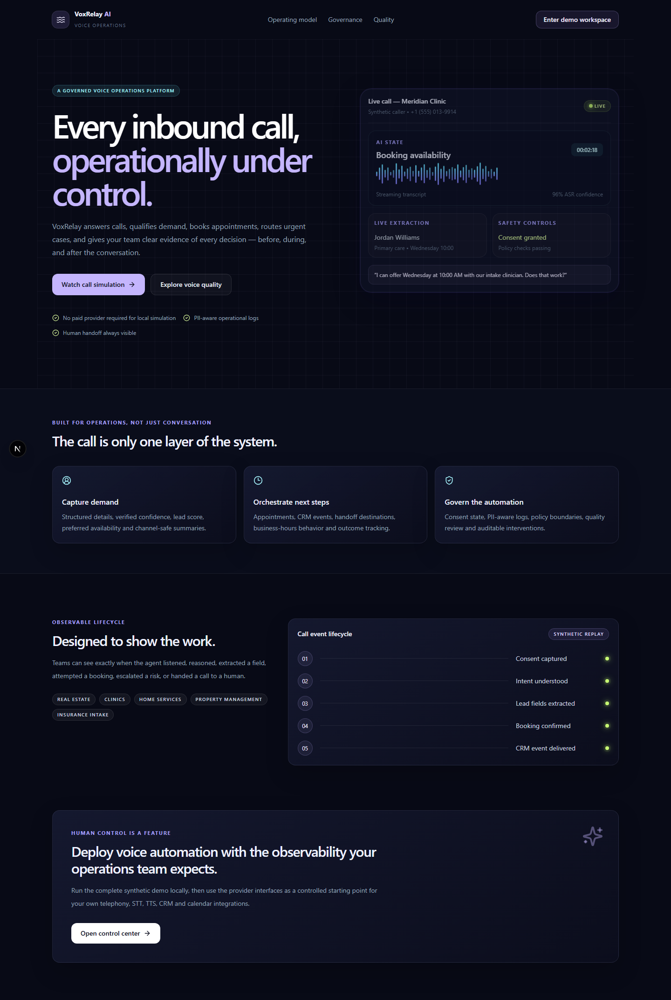

VoxRelay AI is a runnable FastAPI and Next.js monorepo that demonstrates how voice automation can be operated as an observable business system instead of a prompt-only demo. It makes the call lifecycle visible from deterministic inbound simulation through consent, routing, lead capture, booking, CRM delivery, human takeover, quality review, coaching, release governance, reporting, and audit history.

All demo records, users, organizations, transcripts, and screenshots in this repository are synthetic sample data generated for local demonstration.

## Why this project exists

Voice systems often look convincing in isolated happy-path demos while hiding the harder operational problems: unclear handoffs, invisible state transitions, weak release controls, and poor auditability. VoxRelay AI exists to show a more credible product shape:

- deterministic local simulation that works without paid provider keys;
- tenant-aware operations workflows instead of a single-user prototype;
- persisted evidence for calls, transcripts, entities, bookings, sync jobs, and reviews;
- release and approval workflows for agent versions, not just prompt edits;
- explicit privacy, audit, and escalation boundaries for sensitive workflows.

## Core capabilities

| Area | What the repository demonstrates |
|---|---|
| Voice operations | Deterministic simulated inbound calls, ordered event streams, transcripts, extracted entities, cancellation boundaries, handoff requests, and outcome tracking |
| Multi-tenancy and RBAC | Three seeded organizations, workspace switching, membership-backed access, scoped permissions, and tenant-enforced queries |
| Agent governance | Version inventory, evaluation runs, release gates, approval, staging, activation, rollback boundaries, and audit events |
| Supervisor tooling | Live console, queue monitoring, escalation workflows, takeover simulation, search, and operational dashboards |
| Quality and coaching | Review queue, rubric-driven scoring, policy flags, coaching tasks, reviewer feedback, and training-candidate marking |
| CRM and scheduling | Mock CRM sync with idempotency and retry metadata, local appointment workflows, conflict handling, reschedule/cancel paths |
| Reporting and observability | Health endpoints, trace views, scheduled reports, CSV/PDF export, alerts, notifications, and operational rollups |
| Security posture | Password hashing, refresh-session tracking, API key hashing, request IDs, rate limiting, redaction helpers, retention records, and audit evidence |

## Architecture

VoxRelay AI is structured as a monorepo with a Next.js operations console, a FastAPI backend, seeded demo data, and deterministic adapters that keep the default path fully local and reproducible.

### System architecture

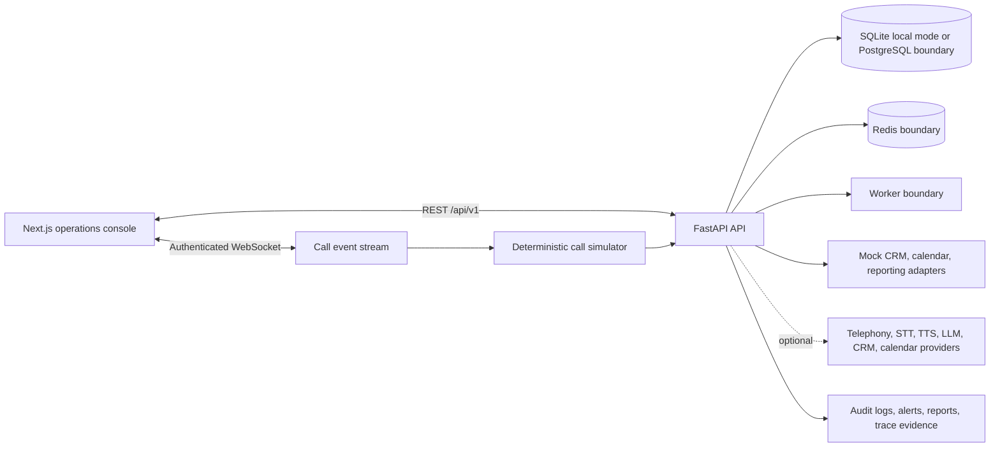

### End-to-end call lifecycle

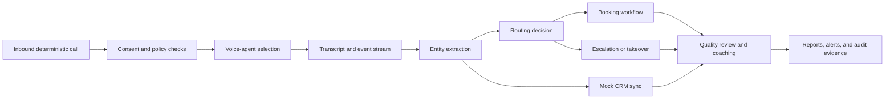

### Agent release governance

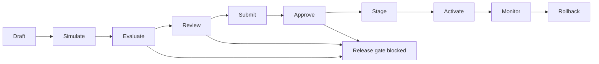

For deeper implementation notes, see [docs/architecture.md](docs/architecture.md), [docs/system-boundaries.md](docs/system-boundaries.md), [docs/agent-governance.md](docs/agent-governance.md), and [docs/websocket-protocol.md](docs/websocket-protocol.md).

## Screenshots

These screenshots come from the real locally running application with seeded demo data.

| | |
|---|---|
| 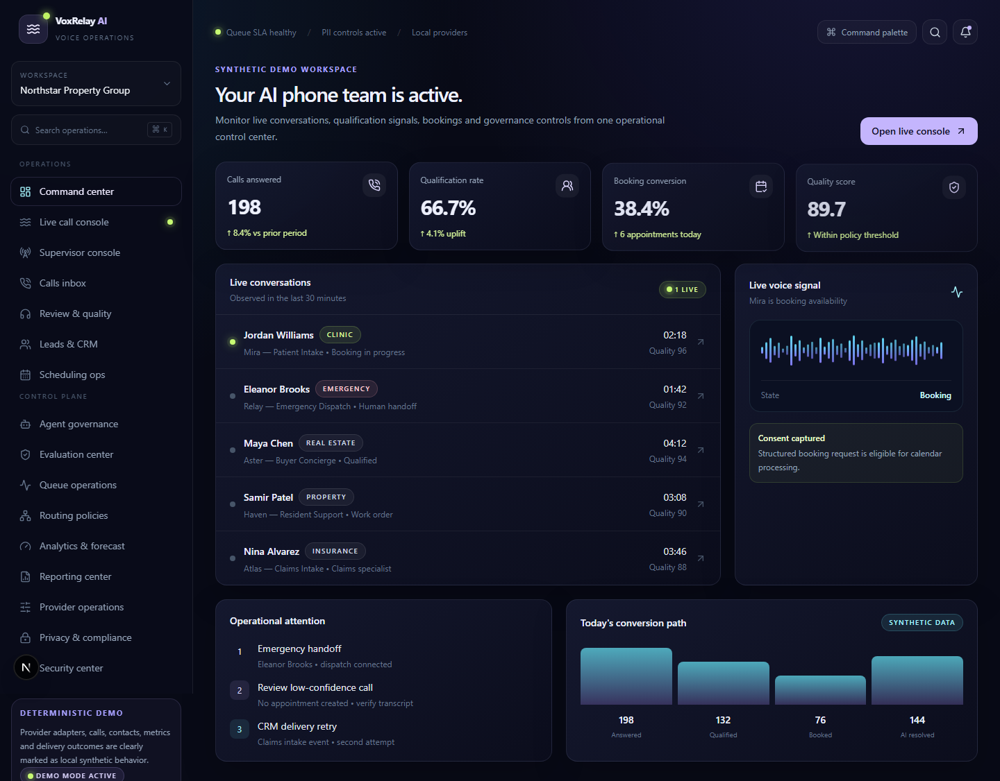 | 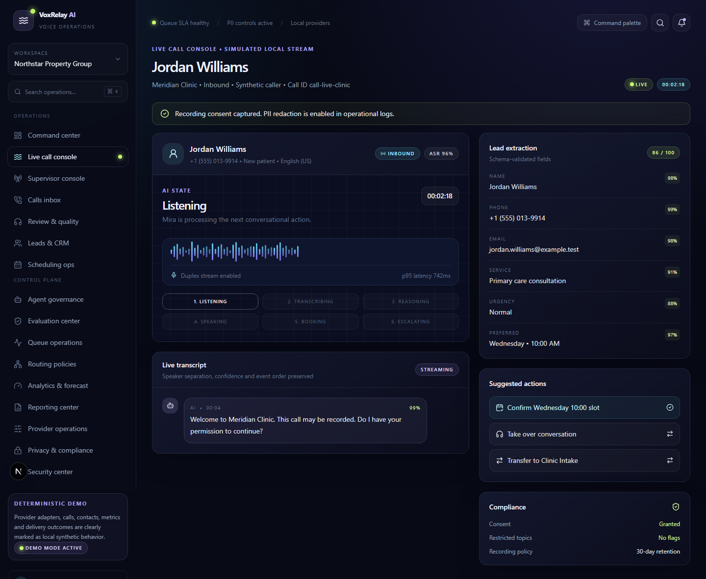 |
| 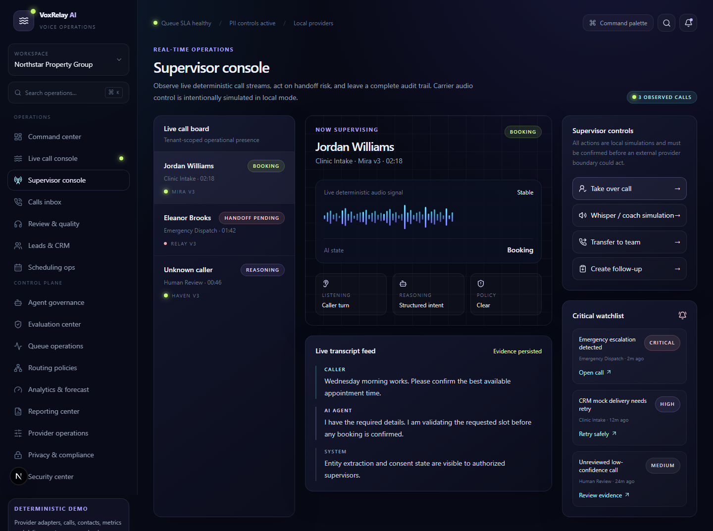 | 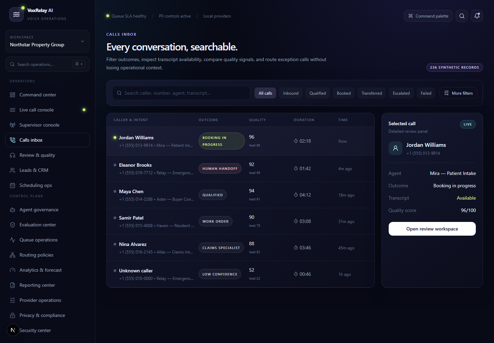 |
| 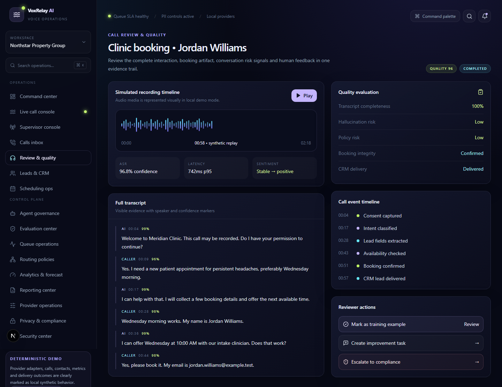 | 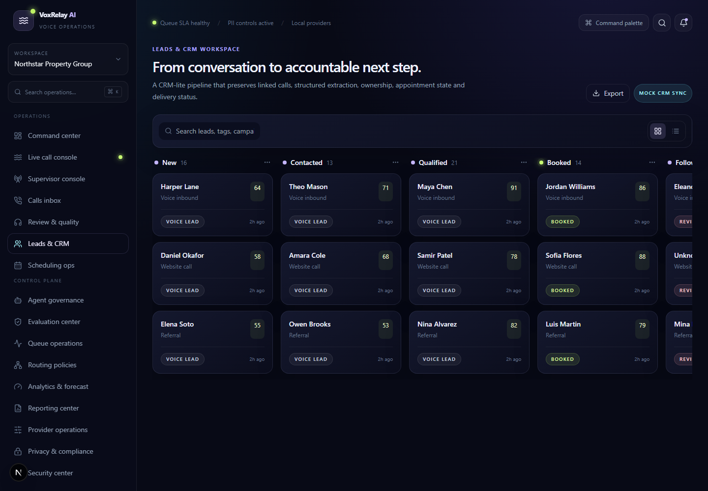 |
| 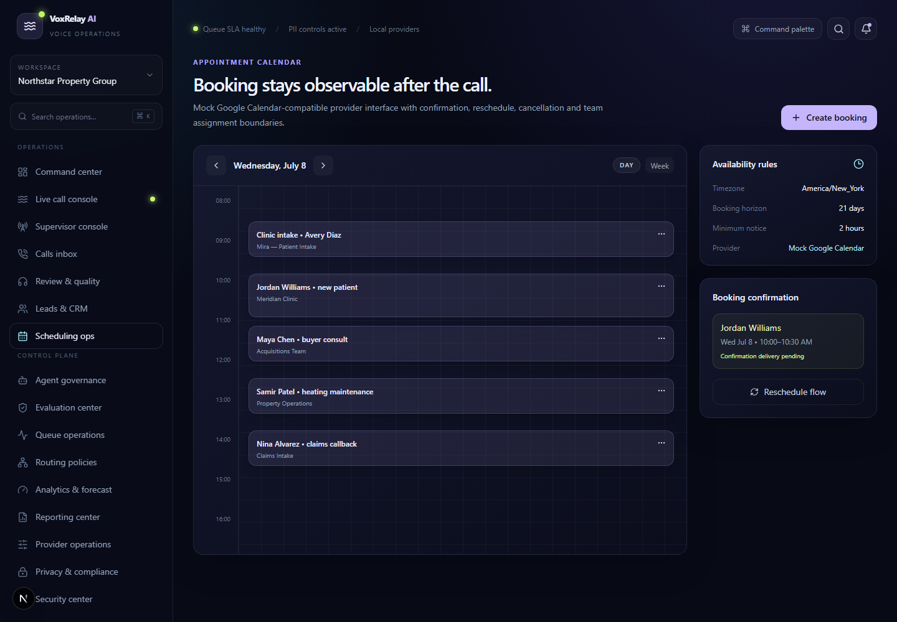 | 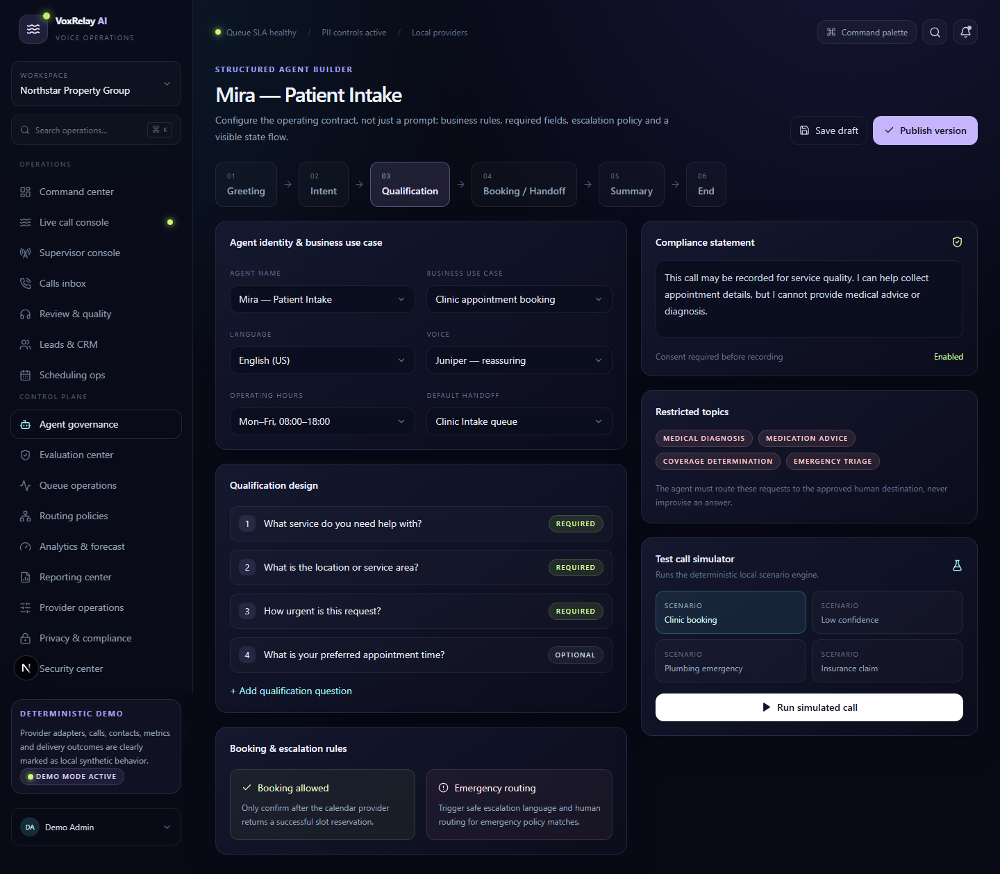 |
| 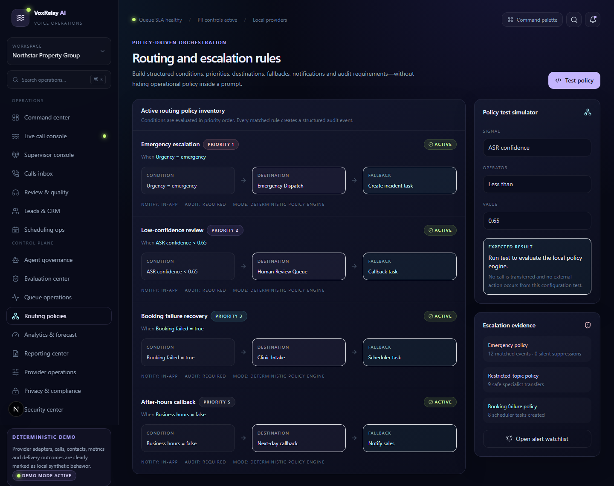 | 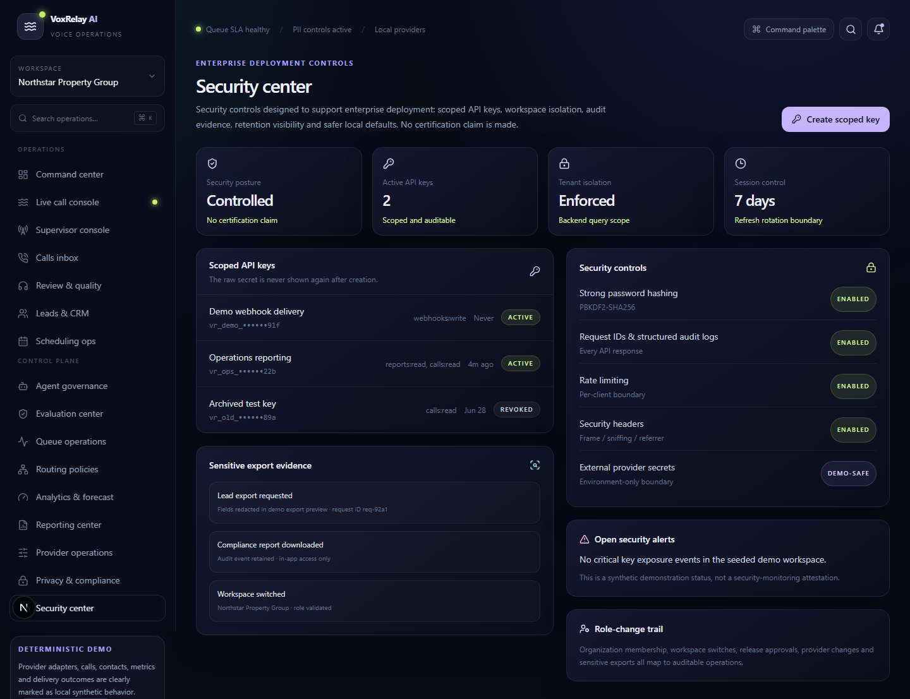 |
| 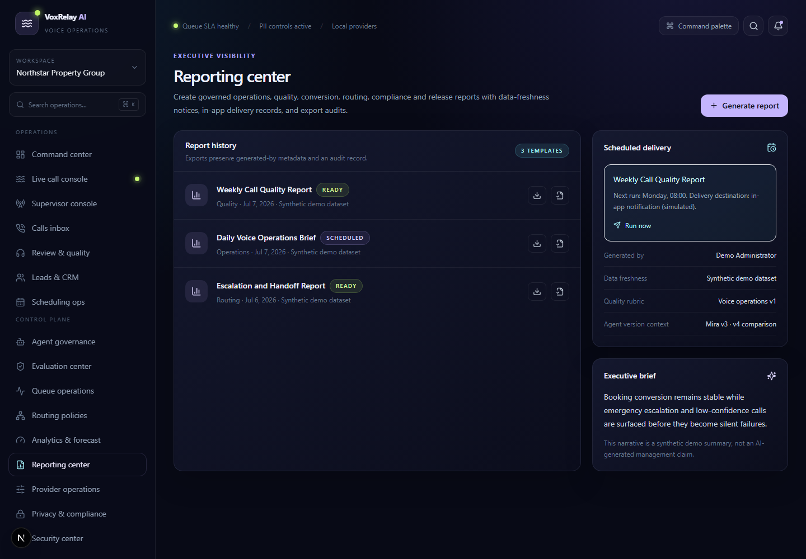 | 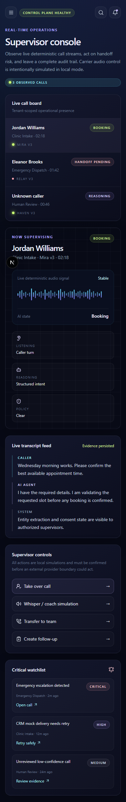 |

Fresh captures can be regenerated with:

```bash
cd apps/web
node scripts/capture-phase3-screenshots.mjs
```

## Technology stack

### Frontend

- Next.js 16 with the App Router
- React 19
- TypeScript
- Tailwind CSS
- TanStack Query
- Playwright for browser smoke coverage

### Backend

- FastAPI
- SQLAlchemy
- Alembic
- Pydantic Settings
- Pytest, Ruff, and MyPy

### Infrastructure and tooling

- SQLite for deterministic local mode
- PostgreSQL and Redis via Docker Compose for boundary validation
- GitHub Actions CI
- Makefile shortcuts for Unix-like environments

## Quick start

### Requirements

- Python 3.12+
- Node 20.9+ or Node 22+
- npm 10+
- Docker Desktop only if you want the PostgreSQL and Redis Compose path

### 1. Configure environment

```powershell
Copy-Item .env.example .env
```

### 2. Start the backend

```powershell
py -3.12 -m venv .venv
.\.venv\Scripts\python -m pip install --upgrade pip
.\.venv\Scripts\python -m pip install -e "apps/api[dev]"
cd apps/api
..\..\.venv\Scripts\python -m alembic upgrade head
..\..\.venv\Scripts\python -m app.seed_cli
..\..\.venv\Scripts\python -m uvicorn app.main:app --reload --port 8000
```

### 3. Start the frontend

In a second terminal:

```powershell
cd apps/web
npm ci
npm run dev
```

### 4. Open the demo

- Web console: `http://localhost:3000`
- API docs: `http://localhost:8000/docs`
- Health: `http://localhost:8000/health`
- Readiness: `http://localhost:8000/api/v1/health/ready`

## Local setup in detail

### Backend

```powershell
py -3.12 -m venv .venv
.\.venv\Scripts\python -m pip install --upgrade pip
.\.venv\Scripts\python -m pip install -e "apps/api[dev]"
cd apps/api
..\..\.venv\Scripts\python -m alembic upgrade head
..\..\.venv\Scripts\python -m app.seed_cli
..\..\.venv\Scripts\python -m uvicorn app.main:app --reload --port 8000
```

Optional worker process:

```powershell
cd apps/api
..\..\.venv\Scripts\python -m app.worker
```

### Frontend

```powershell
cd apps/web
npm ci
npm run dev
```

### Docker Compose workflow

```powershell
docker compose up --build
```

This path validates the PostgreSQL and Redis boundaries. The default demo remains fully local and synthetic even without external providers.

### Makefile shortcuts

If you are on a Unix-like environment with `make` available, the root `Makefile` exposes convenience commands:

```text
make api-install
make migrate
make seed
make api-dev
make web-install
make web-dev
make verify
make screenshots
```

## Demo mode and seeded accounts

All seeded users use the password `DemoPass123!`.

| Role | Account | Default workspace |
|---|---|---|
| Organization Admin | `admin@voxrelay.demo` | All three workspaces |
| Operations Manager | `ops@voxrelay.demo` | CareBridge Clinics |
| Supervisor | `supervisor@voxrelay.demo` | Northstar Property Group |
| Quality Reviewer | `quality@voxrelay.demo` | CareBridge Clinics |
| Scheduler | `scheduler@voxrelay.demo` | CareBridge Clinics |
| Sales Representative | `sales@voxrelay.demo` | Northstar Property Group |
| Compliance Reviewer | `compliance@voxrelay.demo` | Apex Home Services |
| Viewer | `viewer@voxrelay.demo` | Northstar Property Group |
| Voice Agent Manager | `agentmanager@voxrelay.demo` | CareBridge Clinics |

Seeded organizations:

- Northstar Property Group
- CareBridge Clinics
- Apex Home Services

## API usage

The external API surface lives under `/api/v1`.

### Useful endpoints

```text
POST /api/v1/auth/login
POST /api/v1/auth/switch-workspace
GET  /api/v1/calls
POST /api/v1/voice-agents/{id}/simulate
WS   /api/v1/ws/calls/{call_id}?token=...
POST /api/v1/calls/{id}/takeover
POST /api/v1/calls/{id}/transfer
POST /api/v1/calls/{id}/cancel
POST /api/v1/leads/{id}/crm-sync
POST /api/v1/appointments
POST /api/v1/voice-agents/versions/{id}/evaluate
POST /api/v1/voice-agents/versions/{id}/approve
POST /api/v1/reports/generate
GET  /api/v1/search?q=...
GET  /api/v1/health/ready
```

### Example request flow

```bash
curl -X POST http://localhost:8000/api/v1/auth/login \
  -H "Content-Type: application/json" \
  -d '{"email":"admin@voxrelay.demo","password":"DemoPass123!"}'
```

OpenAPI docs are available at `http://localhost:8000/docs`.

## CLI and SDK examples

After the API is running:

```powershell
$env:PYTHONPATH = "packages"
.\.venv\Scripts\python examples\list_calls.py
.\.venv\Scripts\python examples\start_simulated_call.py
.\.venv\Scripts\python examples\generate_report.py
.\.venv\Scripts\python examples\create_followup.py
.\.venv\Scripts\python examples\agent_release_flow.py
```

The lightweight client lives in [packages/voxrelay_client](packages/voxrelay_client).

## Validation commands

### Backend checks

```powershell
cd apps/api
..\..\.venv\Scripts\python -m pytest -q tests
..\..\.venv\Scripts\python -m ruff check app tests
..\..\.venv\Scripts\python -m mypy app
```

### Frontend checks

```powershell
cd apps/web
npm run lint
npm run typecheck
npm run build
```

### Formatting commands

```powershell
cd apps/api
..\..\.venv\Scripts\python -m ruff format app tests
cd apps/web
npm run format
```

### Browser smoke test

```powershell
cd apps/web
npx playwright test
```

### Migrations, seed, and screenshots

```powershell
cd apps/api
..\..\.venv\Scripts\python scripts/check_migrations.py
..\..\.venv\Scripts\python -m app.seed_cli

cd ..\web
node scripts/capture-phase3-screenshots.mjs
```

## Configuration

Copy `.env.example` to `.env` and adjust values as needed. The default path is optimized for local synthetic demo usage.

| Variable | Purpose | Safe local default |
|---|---|---|
| `DATABASE_URL` | Backend database connection | `sqlite:///./voxrelay.db` |
| `REDIS_URL` | Redis boundary for future/Compose flows | `redis://redis:6379/0` |
| `JWT_SECRET` | Access and refresh token signing secret | `change-me-in-production` |
| `JWT_ALGORITHM` | JWT signing algorithm | `HS256` |
| `ACCESS_TOKEN_MINUTES` | Access token lifetime | `60` |
| `REFRESH_TOKEN_DAYS` | Refresh token lifetime | `7` |
| `RATE_LIMIT_PER_MINUTE` | API per-client rate limit | `180` |
| `CORS_ORIGINS` | Allowed browser origins | `http://localhost:3000` |
| `ENVIRONMENT` | Runtime mode guardrails | `development` |
| `DEMO_MODE` | Enables deterministic seeded demo behavior | `true` |
| `NEXT_PUBLIC_API_BASE_URL` | Frontend API origin | `http://localhost:8000` |

Never commit real secrets, production database URLs, or provider credentials.

## Project structure

```text
voxrelay-ai/
├── apps/
│   ├── api/
│   │   ├── app/                  # FastAPI domain logic, security, services, seed, worker
│   │   ├── alembic/versions/     # Database migration history
│   │   ├── scripts/              # Migration checks
│   │   └── tests/                # Backend test suite
│   └── web/
│       ├── app/                  # Next.js App Router UI
│       ├── e2e/                  # Playwright smoke coverage
│       ├── public/               # Runtime public assets
│       └── scripts/              # Screenshot automation
├── assets/screenshots/           # Real repository screenshots
├── docs/                         # Architecture, deployment, security, and domain guides
├── examples/                     # API and SDK usage examples
├── packages/voxrelay_client/     # Lightweight Python client
├── .github/workflows/ci.yml      # CI pipeline
├── docker-compose.yml
├── Makefile
└── .env.example
```

## Documentation map

- [Architecture](docs/architecture.md)
- [Demo guide](docs/demo-guide.md)
- [Deployment](docs/deployment.md)
- [Database migrations](docs/database-migrations.md)
- [Authentication and RBAC](docs/authentication-and-rbac.md)
- [Provider adapters](docs/provider-adapters.md)
- [Quality assurance](docs/quality-assurance.md)
- [Reporting](docs/reporting.md)
- [Security](docs/security.md)
- [Testing](docs/testing.md)
- [Roadmap](docs/roadmap.md)
- [Limitations](docs/limitations.md)

## Security notes

VoxRelay AI includes several security-oriented patterns:

- role and permission checks;
- tenant-scoped data access;
- refresh-session rotation and revocation;
- API key hashing and revocation;
- request IDs and rate limiting;
- redaction helpers for sensitive note display;
- audit events for high-signal workflows.

These controls do not constitute a certification, formal threat model, or compliance guarantee. Review [SECURITY.md](SECURITY.md) and [docs/security.md](docs/security.md) before representing the project as deployable in regulated or high-risk environments.

## Known limitations

- No real telephony, browser microphone capture, STT, TTS, LLM inference, carrier integration, or live provider traffic is enabled by default.
- SQLite mode is intended for local deterministic demonstrations, not production deployment.
- Redis and worker processes are modeled as architecture boundaries in the local path.
- Historical migrations should be reviewed and expanded before any serious production rollout.
- The project is honest about simulated and mocked behavior by design; it is not a benchmark or customer-proof artifact.

## Contributing

See [CONTRIBUTING.md](CONTRIBUTING.md). In short:

- keep demo data synthetic;
- add tests for behavior changes;
- preserve the no-key local path;
- document provider boundaries honestly;
- update screenshots or docs when visible behavior changes.

## Roadmap

- Expand provider adapters beyond the current mock boundaries.
- Add richer browser-based call playback and transcript timeline controls.
- Harden deployment guidance for managed PostgreSQL, Redis, secrets, and observability stacks.
- Add broader end-to-end test coverage across multi-tenant workflows and release governance paths.
- Publish versioned API and SDK documentation.

## License

This project is released under the [MIT License](LICENSE).

## Attribution

VoxRelay AI is built on top of open-source software including FastAPI, SQLAlchemy, Pydantic, Alembic, Next.js, React, Tailwind CSS, TanStack Query, Playwright, Recharts, Lucide, and Framer Motion. The repository does not ship third-party proprietary datasets, model weights, or copied customer assets.
