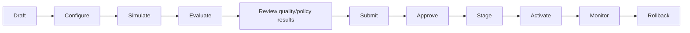

# Agent governance

Voice agents are organization-owned. Version status is explicit: Draft, Testing, In review, Approved, Staged, Active, Deprecated, Archived and Rolled back. Activation checks release gates rather than letting a configured agent go live immediately.

Release gates require a passing evaluation, emergency/consent/restricted-topic coverage, no critical unresolved blocker and an approval record. The version compare screen shows changes and synthetic performance proxies; those metrics are not external production claims.
