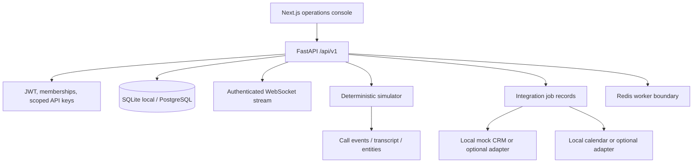

# Architecture

VoxRelay AI separates the local deterministic experience from optional production provider boundaries. The API is the organization-scoped source of truth for calls, events, transcript segments, evidence, leads, appointments, governance records, jobs, reports and audit history.

In demo mode, the deterministic simulator is fully functional and default. External provider records are explicit status/configuration boundaries and do not initiate paid traffic without credentials and an adapter implementation.
