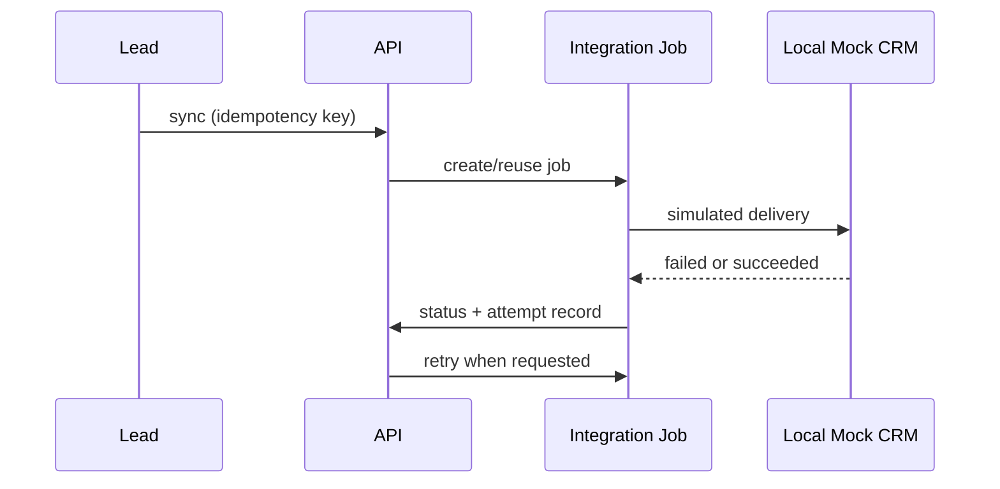

# CRM integration reliability

The local mock CRM flow is implemented: a lead sync creates an idempotent integration job, a simulated failure can be recorded, a retry safely reuses the job, delivery attempts are stored and audit events preserve context. The lead remains stored locally after failure.

HubSpot, Salesforce, Zoho and generic webhook providers are optional adapter boundaries only.
