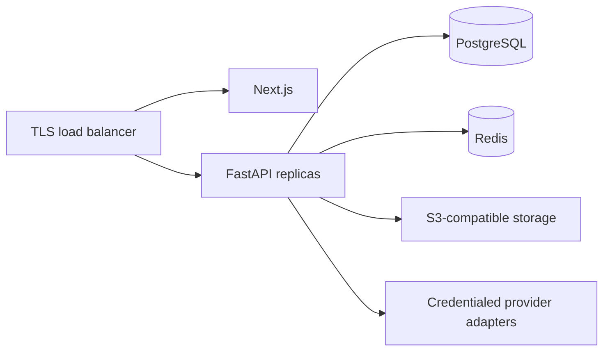

# Deployment

For a non-demo deployment, use PostgreSQL, Redis, managed object storage, a secret manager, TLS termination, scoped CORS origins, secure cookie/session policy where applicable, structured log shipping and explicit migrations.

The supplied Compose configuration is development reference infrastructure, not a high-availability deployment topology.
