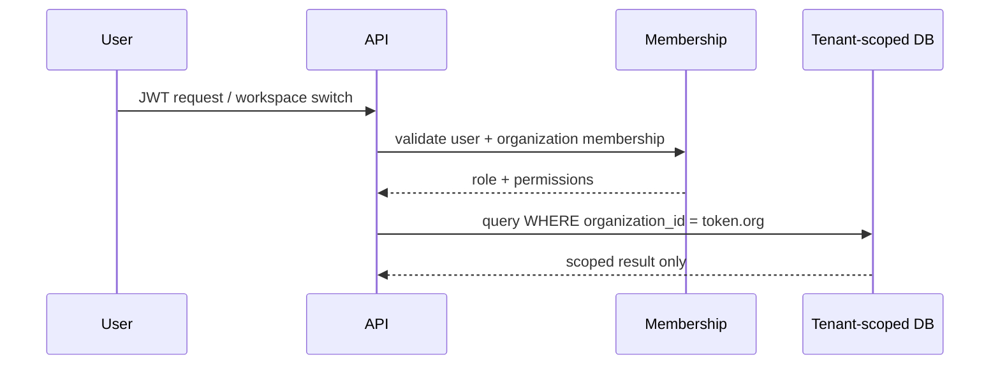

# Multi-tenancy and RBAC

Every critical Phase 2 record has an `organization_id`; tenant scope is enforced from JWT membership or a scoped API key, not a frontend selection. Calls, leads, appointments, agents, agent versions, reports, providers, alerts and audit events are fetched with organization predicates. `require_org_record` denies cross-tenant entity access.

| Role | Primary controls |
|---|---|
| Organization Admin | Workspace, users, APIs, providers, approvals, retention |
| Operations Manager | Calls, leads, calendars, routing, reports, analytics |
| Voice Agent Manager | Agent configuration, versions, evaluation, submission |
| Supervisor | Monitor, transfer, takeover, review, escalations |
| Quality Reviewer | Review, feedback, coaching, training examples |
| Scheduler | Calendar, booking/reschedule/cancel |
| Sales Representative | Assigned leads and follow-ups |
| Compliance Reviewer | Consent, risk, governance, reports |
| Viewer | Tenant-scoped read-only surfaces |

The test suite verifies calls, leads, agents and reports cannot be read from another workspace.
