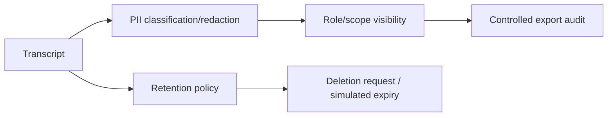

# Privacy, compliance and retention

VoxRelay includes controls designed to support privacy-aware and policy-governed voice operations: consent states, PII classifications, redaction helpers, restricted-topic/emergency flags, retention records, deletion requests, export history and audit events.

The project is not a legal compliance certification. A real deployment needs policy ownership, jurisdiction-specific consent analysis, encryption/key management, provider agreements and an independent security review.
