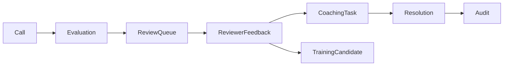

# Quality assurance and coaching

Quality records expose consent, greeting, identity, extraction completeness, booking/handoff correctness, emergency routing, restricted-topic policy, transcript completeness, latency, PII handling and close quality. A reviewer can score a call, add feedback, flag a policy issue, request second review, mark a training candidate and create a coaching task.

Quality labels are Excellent, Good, Needs review, At risk and Failed policy gate. In demo mode, sentiment and hallucination indicators are synthetic/rule-assisted signals.
