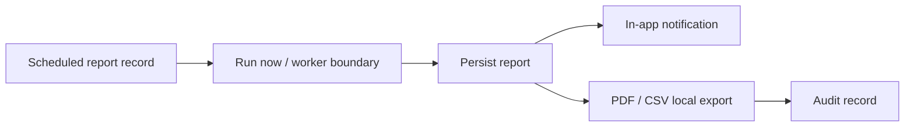

# Reporting

Report templates include daily operations, quality, conversion, appointment, agent, escalation, compliance, CRM health, queue, release evaluation and executive briefs. Demo generation persists a report record, metadata, local in-app notification and an export ID. CSV is a simple metric export; PDF is a deliberately small local text export.

Email and webhook delivery are marked simulated until an external notification adapter is configured.
