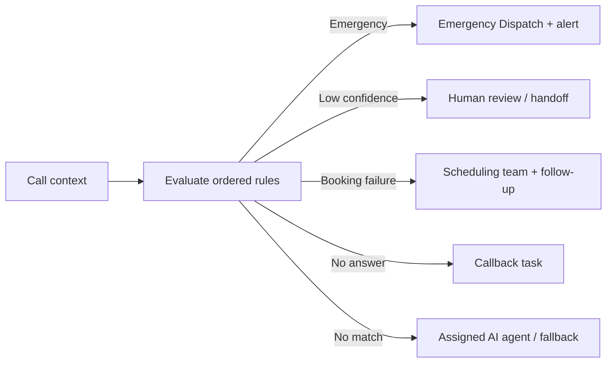

# Routing and escalation

Routing is structured rather than prompt-only: conditions, priority, destination, fallback, notification and audit requirement are stored as tenant-owned rules. Inputs include urgency, business hours, language, service type, confidence, sentiment/risk and booking/CRM failure.

The app includes emergency, low-confidence, business-hours, language, VIP placeholder, booking-failure, CRM-failure, restricted-topic, complaint, sentiment-risk and no-answer patterns. The provider remains simulated; no real emergency dispatch is contacted.
