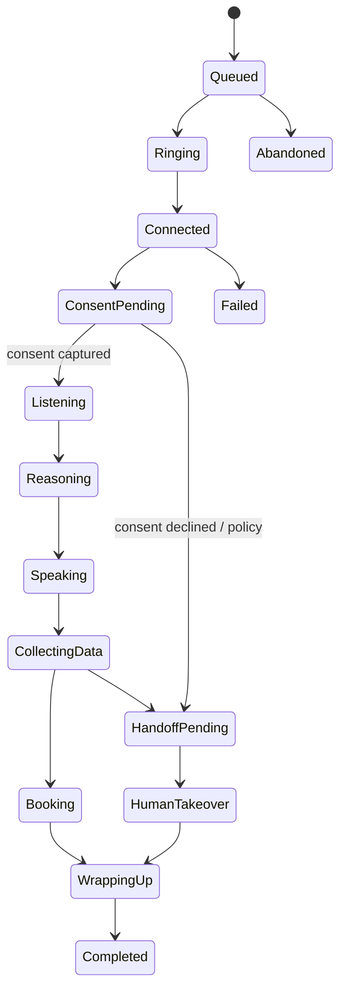

# Voice state machine

The simulation persists meaningful transitions as call events. The local simulator intentionally does not emulate a carrier connection; it demonstrates the lifecycle and control surfaces.

A transcript segment, extraction event, booking event, handoff event, alert and audit record can be attached to a transition. Emergency and restricted-topic conditions are never silently ignored; the local routing policy creates visible escalation artifacts.
